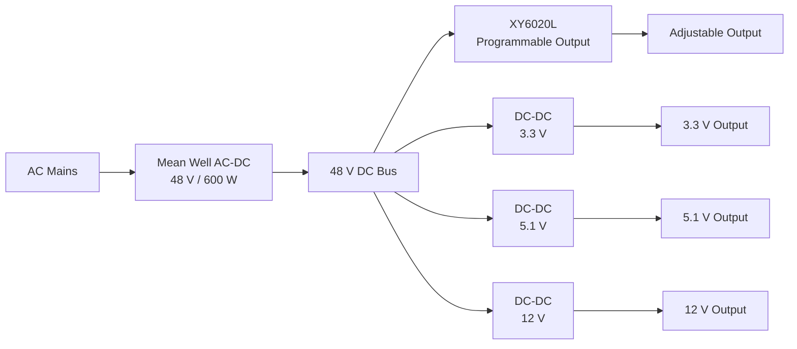

<table align="right">
  <tr>
    <td><b>🇬🇧 English</b></td>
    <td><a href="./README_RU.md">🇷🇺 Русский</a></td>
  </tr>
</table>

# ⚡ Modular 600 W Laboratory Power Supply

A multi-output laboratory power supply built around a **48 V / 600 W Mean Well AC-DC power stage**.

The 48 V rail acts as a common DC power bus and feeds several independent DC-DC converters in parallel:

- one programmable output based on **XY6020L**;
- fixed **3.3 V** output;
- fixed **5.1 V** output;
- fixed **12 V** output.

The design provides both an adjustable laboratory channel and several permanently available voltage rails for embedded electronics, actuators and bench development.

---

## ⚙️ Power Architecture



All DC-DC stages are connected to the same 48 V source in parallel.

The total available power is therefore limited by the **600 W AC-DC source**, regardless of the individual converter ratings.

---

## 🔌 Output Channels

| Channel | Type | Converter |
|---|---|---|
| Adjustable | Programmable voltage/current output | XY6020L |
| 3.3 V | Fixed | DC-DC, 200 W / 15 A class |
| 5.1 V | Fixed | DC-DC, 200 W / 15 A class |
| 12 V | Fixed | DC-DC, 200 W / 15 A class |

The fixed converters are rated for up to **15 A**, but the actual available output power depends on output voltage, converter efficiency and thermal conditions.

For example, at the 15 A current limit:

```text
3.3 V × 15 A = 49.5 W
5.1 V × 15 A = 76.5 W
12 V  × 15 A = 180 W
```

The converter module power rating therefore represents an upper converter capability rather than 200 W being available from every low-voltage rail.

---

## 🎛️ Programmable Channel

The **XY6020L** provides the general-purpose adjustable laboratory output.

It is supplied directly from the 48 V bus and is used when a project requires a voltage or current other than the fixed rails.

This separates the power supply into two use cases:

```text
Fixed rails
    ↓
Frequently used embedded voltages
3.3 V / 5.1 V / 12 V

Programmable rail
    ↓
Development, testing and experiments
```

This avoids repeatedly configuring the main programmable channel for common supply voltages.

---

## 🔋 Common 48 V Bus

The Mean Well AC-DC supply forms the central power stage:

```text
AC mains
   ↓
48 V / 600 W
   ↓
Common DC bus
   ↓
Independent DC-DC channels
```

Using a relatively high-voltage intermediate bus reduces current in the internal distribution wiring compared with distributing the same power directly at low voltages.

Each output converter then performs local conversion to the required voltage.

---

## 🧰 Intended Use

The power supply was designed primarily for electronics and robotics development.

Typical loads include:

- STM32 and other embedded boards;
- sensors and communication modules;
- 5 V electronics;
- 12 V peripherals;
- motors and actuators;
- prototype PCBs;
- general laboratory testing.

The fixed outputs provide immediately available supply rails while the programmable channel remains free for the device currently under development.

---

## 🧱 Mechanical Design

The enclosure was designed in **FreeCAD**.

The repository contains the original parametric CAD model:

```text
3d models/
└── source/
    └── Блок питания.FCStd
```

The mechanical design integrates the AC-DC source, DC-DC stages and external output interfaces into a single bench unit.

---

## 🔧 Embedded / Low-Level Code

The repository also contains early low-level STM32F103 firmware components written using direct register access.

Implemented modules include:

- GPIO;
- USART;
- timers;
- PWM;
- EXTI.

This code represents part of the low-level embedded development work associated with the project and predates the larger reusable STM32 driver library used in later projects.

---

## 📁 Repository Structure

```text
PowerSupply/
├── 3d models/
│   └── source/
│       └── Блок питания.FCStd
├── README.md
└── README_RU.md
```

---

## ✅ Project Status

- [x] 48 V / 600 W AC-DC power stage
- [x] Common 48 V internal bus
- [x] Programmable XY6020L channel
- [x] Fixed 3.3 V output
- [x] Fixed 5.1 V output
- [x] Fixed 12 V output
- [x] Independent parallel DC-DC conversion stages
- [x] FreeCAD enclosure design
- [x] Physical laboratory power supply assembly
