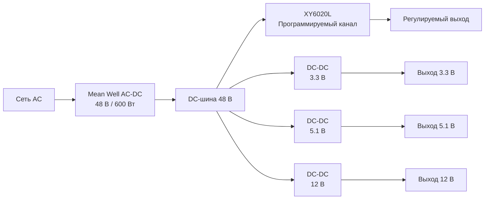

<table align="right">
  <tr>
    <td><a href="./README.md">🇬🇧 English</a></td>
    <td><b>🇷🇺 Русский</b></td>
  </tr>
</table>

# ⚡ Модульный лабораторный блок питания 600 Вт

Многоканальный лабораторный блок питания на основе **AC-DC Mean Well 48 В / 600 Вт**.

Выход 48 В используется как общая силовая DC-шина, от которой параллельно питаются несколько независимых DC-DC преобразователей:

- один программируемый канал на **XY6020L**;
- фиксированный выход **3.3 В**;
- фиксированный выход **5.1 В**;
- фиксированный выход **12 В**.

Такая архитектура одновременно даёт регулируемый лабораторный канал и постоянно доступные напряжения для embedded-электроники, приводов и стендовой разработки.

---

## ⚙️ Архитектура питания



Все DC-DC преобразователи подключены параллельно к одному источнику 48 В.

Поэтому суммарная доступная мощность всей системы ограничена **600-ваттным AC-DC источником**, независимо от номинальной мощности отдельных преобразователей.

---

## 🔌 Выходные каналы

| Канал | Тип | Преобразователь |
|---|---|---|
| Регулируемый | Программируемые напряжение и ток | XY6020L |
| 3.3 В | Фиксированный | DC-DC класса 200 Вт / 15 А |
| 5.1 В | Фиксированный | DC-DC класса 200 Вт / 15 А |
| 12 В | Фиксированный | DC-DC класса 200 Вт / 15 А |

Фиксированные преобразователи рассчитаны на ток до **15 А**, однако фактически доступная мощность зависит от выходного напряжения, КПД преобразователя и теплового режима.

Например, при токе 15 А:

```text
3.3 В × 15 А = 49.5 Вт
5.1 В × 15 А = 76.5 Вт
12 В  × 15 А = 180 Вт
```

Таким образом, номинал преобразователя 200 Вт является предельной характеристикой самого DC-DC модуля, а не означает наличие 200 Вт на каждом низковольтном выходе.

---

## 🎛️ Программируемый канал

**XY6020L** используется как основной универсальный регулируемый выход.

Он питается непосредственно от шины 48 В и используется тогда, когда проекту требуется напряжение или ограничение тока, отличающееся от фиксированных выходов.

Фактически БП разделён на два типа каналов:

```text
Фиксированные выходы
        ↓
Часто используемые напряжения
3.3 В / 5.1 В / 12 В

Программируемый выход
        ↓
Разработка, испытания и эксперименты
```

Благодаря этому не требуется постоянно перенастраивать регулируемый канал для питания типовой электроники.

---

## 🔋 Общая шина 48 В

Mean Well выполняет роль центрального силового каскада:

```text
Сеть AC
   ↓
48 В / 600 Вт
   ↓
Общая DC-шина
   ↓
Независимые DC-DC каналы
```

Использование промежуточной шины с относительно высоким напряжением позволяет уменьшить токи во внутренней силовой разводке по сравнению с распределением той же мощности непосредственно на низком напряжении.

Далее каждый выходной преобразователь локально формирует необходимое напряжение.

---

## 🧰 Назначение

Блок питания проектировался в первую очередь для разработки электроники и робототехнических систем.

Типичные нагрузки:

- STM32 и другие embedded-платы;
- датчики и интерфейсные модули;
- электроника на 5 В;
- периферия на 12 В;
- двигатели и приводы;
- прототипы печатных плат;
- стендовые испытания.

Фиксированные выходы постоянно готовы для типовых нагрузок, а программируемый канал остаётся свободным для текущего разрабатываемого устройства.

---

## 🧱 Механическая часть

Корпус блока питания спроектирован в **FreeCAD**.

Исходная параметрическая модель находится в репозитории:

```text
3d models/
└── source/
    └── Блок питания.FCStd
```

Механическая конструкция объединяет AC-DC источник, DC-DC преобразователи и внешние интерфейсы в одном настольном устройстве.

---

## 🔧 Embedded / низкоуровневый код

В репозитории также сохранились ранние низкоуровневые модули для STM32F103, написанные через прямую работу с регистрами.

Реализованы:

- GPIO;
- USART;
- таймеры;
- PWM;
- EXTI.

Этот код относится к раннему этапу embedded-разработки проекта и предшествует более крупной переиспользуемой библиотеке STM32-драйверов, появившейся в последующих проектах.

---

## 📁 Структура репозитория

```text
PowerSupply/
├── 3d models/
│   └── source/
│       └── модель корпуса FreeCAD
│
├── app/
│   └── firmware/
│       └── низкоуровневый код STM32F103
│
├── README.md
└── README_RU.md
```

---

## ✅ Состояние проекта

- [x] AC-DC каскад 48 В / 600 Вт
- [x] Общая внутренняя шина 48 В
- [x] Программируемый канал XY6020L
- [x] Фиксированный выход 3.3 В
- [x] Фиксированный выход 5.1 В
- [x] Фиксированный выход 12 В
- [x] Независимые параллельные DC-DC преобразователи
- [x] Проект корпуса в FreeCAD
- [x] Физически собранный лабораторный блок питания
